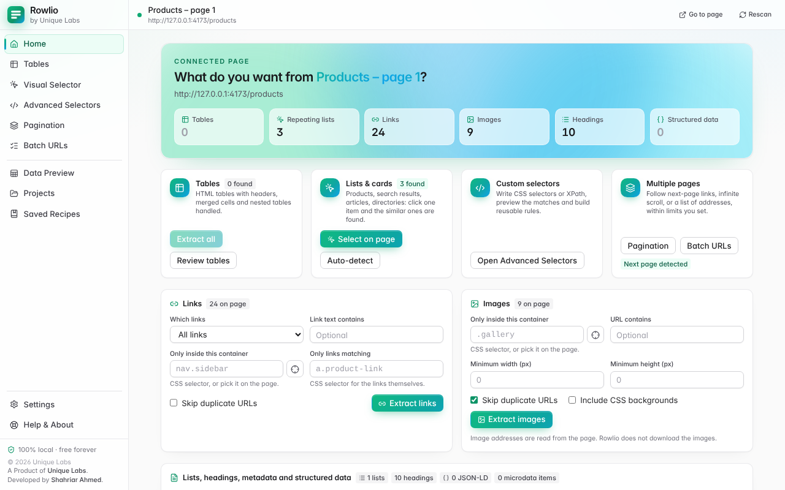
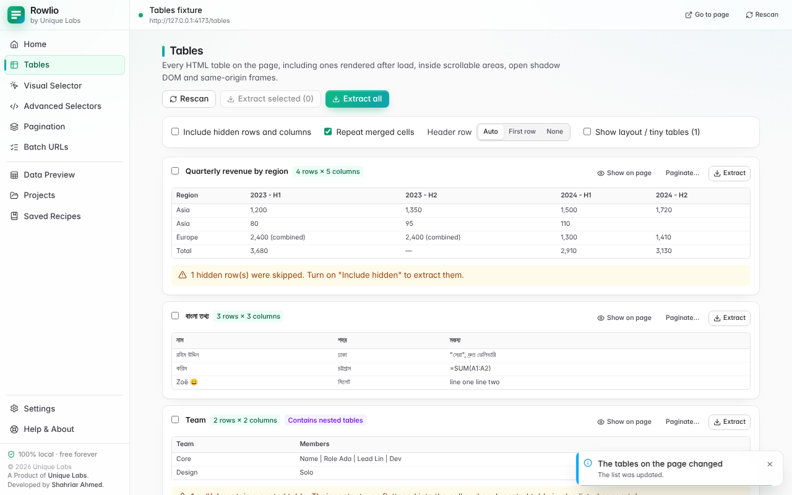
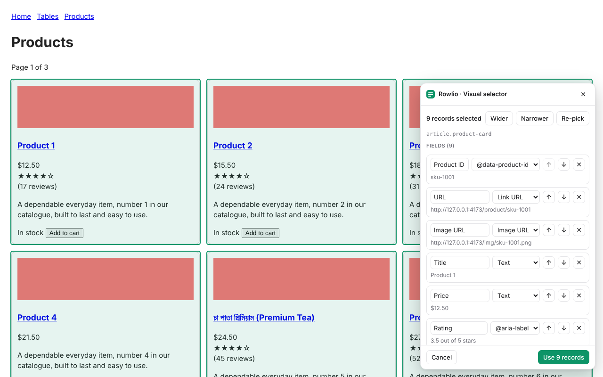
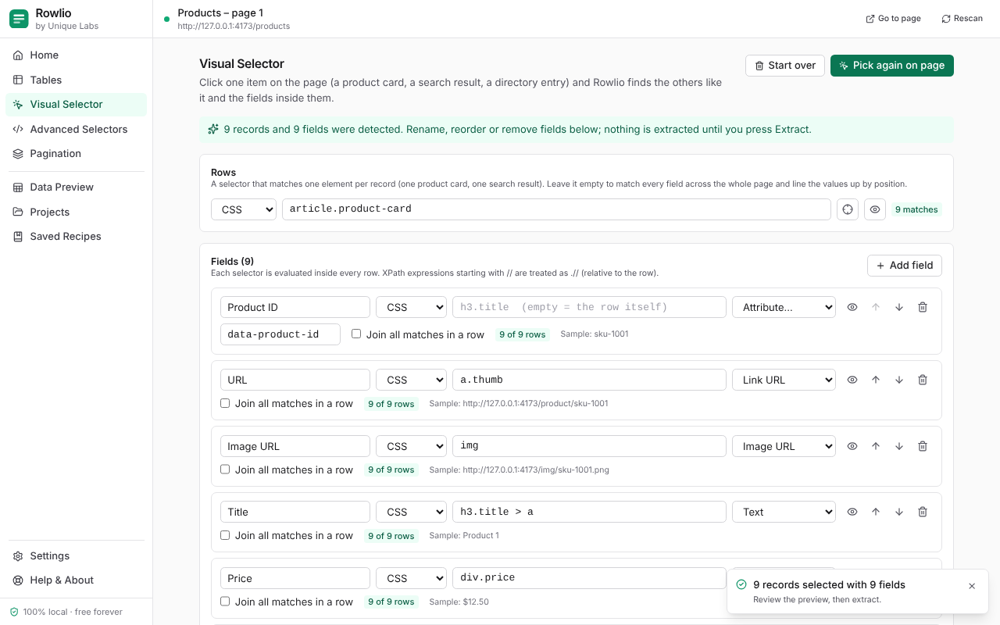
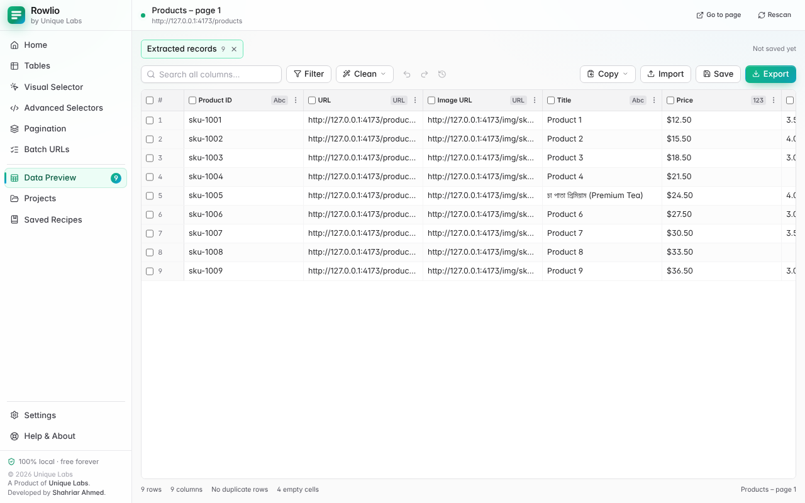
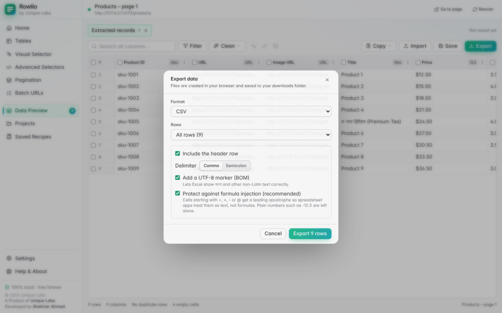
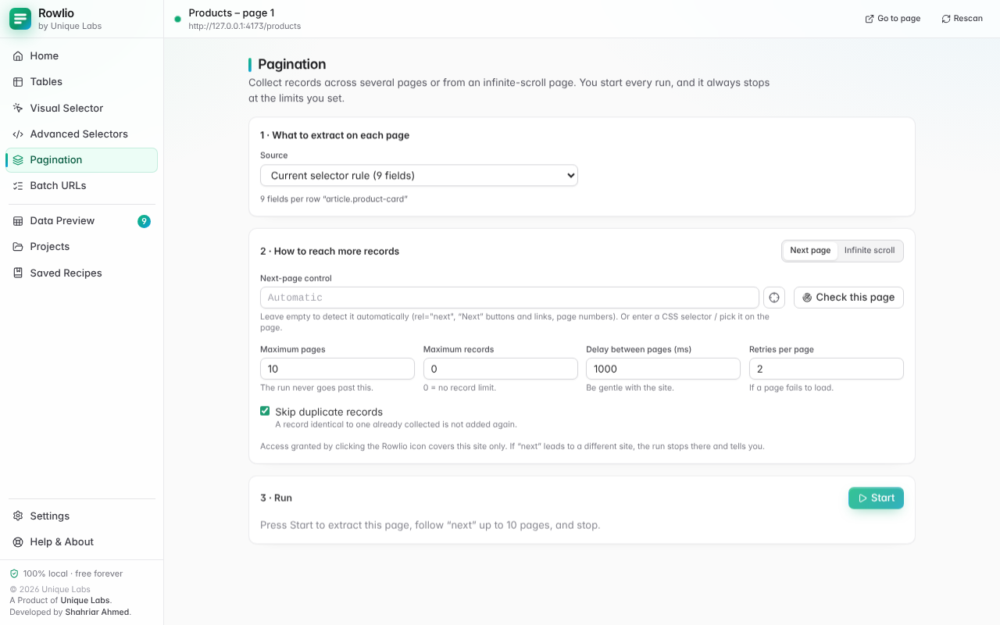
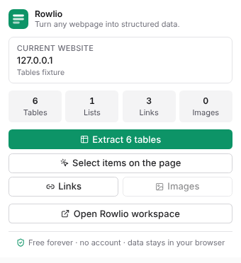

# Rowlio

**Rowlio: Web Scraper & Data Extractor** — *Turn any webpage into structured data.*
A Product of [Unique Labs](https://www.uniquelabs.org). Developed by
[Shahriar Ahmed](https://t.me/igfrostt).

Rowlio turns tables, product listings, search results, links, images, contact details and
page metadata into clean rows you can review, tidy up and export to CSV, Excel, JSON,
JSON Lines, TSV, Markdown or HTML. Everything happens inside your browser: no account, no
server, no usage limits, no premium tier.



| | |
|---|---|
|  |  |
|  |  |
|  |  |

*Screenshots are generated from the local test site with `npm run screenshots`.*
The popup: 

## What it does

- **Tables** – finds every HTML table (also ARIA grids, tables in open shadow DOM and
  same-origin frames, and tables rendered after load). Handles multi-row headers,
  `rowspan` / `colspan`, nested tables, hidden rows and columns, captions.
- **Visual selector** – click one item on the page; Rowlio finds the similar ones and the
  fields inside them (title, price, image, link, rating, reviews, date, availability,
  product id, tags …). Rename, reorder, remove or add fields by clicking. Falls back to
  "point at two examples" when no pattern is found.
- **Advanced selectors** – CSS selectors and XPath with validation, match counts, sample
  previews and on-page highlighting. Extract text, HTML, attributes, link URLs, image
  sources. Multi-field rules with a row selector, or column mode.
- **Links, images, lists, headings, breadcrumbs, metadata, JSON-LD, microdata.**
- **Contacts** – email addresses, phone numbers and social profile links that the page
  shows or links to.
- **Pagination and infinite scroll** – next links / buttons, page numbers, or your own
  selector; always user-started and bounded (pages, records, scrolls, time), with progress,
  retries, duplicate detection and a Stop button.
- **Batch URLs** – run one extraction over a list of pages you supply (pasted, or taken
  from a URL column of data you already extracted). Bounded, paced, stoppable; every row
  records the page it came from.
- **Data preview** – virtualised spreadsheet-style grid: edit cells, sort, search, filter,
  resize / reorder / rename columns, remove rows and columns, detect duplicates and empty
  values. Cleaning tools: trim, normalise whitespace, change case, extract numbers, parse
  dates, normalise URLs, find & replace, extract by pattern (regex), fill down, split and
  combine columns, add rows and columns, per-column summary. Full undo / redo and
  "restore original".
- **Import** – open a CSV, TSV, JSON or JSON Lines file from your computer and clean or
  convert it with the same tools.
- **Export** – CSV, XLSX, JSON, JSONL, TSV, Markdown, HTML and clipboard, UTF-8
  throughout, with formula-injection protection.
- **Projects and recipes** – save results locally (IndexedDB); save extraction settings as
  reusable recipes that are offered again on matching pages.
- **A polished interface** – animated, with optional sound effects that are synthesised
  in the browser (no audio files, nothing downloaded). Both can be switched off in
  Settings, and the system "reduce motion" preference is respected.

The complete list, including what is *not* supported, is in [docs/FEATURES.md](docs/FEATURES.md).

## Install (from this repository)

Requirements: Node.js 20.19+ and Chrome 120+.

```bash
npm install
```

```bash
npm run build
```

Then in Chrome:

1. Open `chrome://extensions`.
2. Turn on **Developer mode**.
3. Click **Load unpacked** and choose the `dist` folder.
4. Pin Rowlio to the toolbar. Open any webpage and click the icon.

To produce the archive for the Chrome Web Store:

```bash
npm run package
```

This writes `release/rowlio-<version>.zip`.

The same archive is offered for download on the website (below), for people who want to
install it without building.

## Using it

1. Open a webpage.
2. Click the Rowlio icon. The popup shows what the page contains.
3. Choose **Extract tables**, **Select items on the page**, **Links**, **Images**, or open
   the workspace for everything else.
4. Review and clean the data in the Data Preview.
5. Export, or save as a project. Save the extraction settings as a recipe to reuse them.

Keyboard shortcuts (change them at `chrome://extensions/shortcuts`):
`Alt+Shift+R` popup · `Alt+Shift+W` open the workspace for the current tab ·
`Alt+Shift+S` start the visual selector.

## Website

`website/` holds a static, dependency-free marketing site (one page plus a privacy page).
It loads nothing from other origins: no analytics, no CDN, no web-font service.

```bash
npm run website
```

builds it into `website-dist/`, filling in the product name, tagline, credits and version
from `brand.config.json` and `package.json`, and adding the screenshots, icons and the
packaged extension.

```bash
npm run website:preview
```

serves it on `http://127.0.0.1:4321`.

**Deploying to Vercel:** import this repository and deploy the repository root. The
committed [`vercel.json`](vercel.json) tells Vercel to skip dependency installation, run
`node scripts/website.mjs` and serve `website-dist/`; no settings need to be changed in
the dashboard. If the Vercel project's Root Directory is set to `website` instead,
`website/vercel.json` does the same job from there (it needs Vercel's default "include
files outside the root directory" setting left on). The download on the site is `website/downloads/rowlio-<version>.zip`,
which `npm run package` followed by `npm run website` refreshes. Commit it after a
release. This deployment has not been run from here: the build was verified locally only.

## Development

```bash
npm run dev
```

rebuilds `dist/` on every change (reload the extension on `chrome://extensions` to pick it
up).

```bash
npm run typecheck
```

```bash
npm test
```

```bash
npm run test:e2e
```

`npm run verify` runs all three. Details: [docs/DEVELOPMENT.md](docs/DEVELOPMENT.md) and
[docs/TESTING.md](docs/TESTING.md).

## Architecture in one paragraph

A Manifest V3 extension built with Vite, React, TypeScript and Tailwind CSS. The
**content script** is not registered in the manifest: it is injected on demand into the
one tab you invoke Rowlio on, and contains the DOM-only **extraction engine** plus the
in-page visual selector (vanilla DOM inside a closed shadow root). The **workspace** (a
full extension page) orchestrates everything: it talks to the content script over a typed
message protocol, streams large results in chunks, cleans data (in a Web Worker when
large), stores projects in IndexedDB and builds export files locally. The **service
worker** is deliberately tiny and stateless: it opens the workspace and handles keyboard
shortcuts. There is no backend. See [docs/ARCHITECTURE.md](docs/ARCHITECTURE.md).

**Why plain Vite instead of WXT or CRXJS?** The extension needs exactly three bundles
(pages, one classic-script content file, one service-worker module) and a generated
manifest. A build script of about 190 lines (`scripts/build.mjs`) does that with no framework
runtime, no injected reload client and no extra abstraction to keep up to date, and it
makes the production bundle easy to audit: what you read in `src/` is what ships.

## Privacy commitments

- Two install-time permissions: `activeTab` and `scripting`. No access to any site until
  you click the icon there.
- No network requests of its own; the extension pages' Content Security Policy forbids
  them (`connect-src 'self'`). The only links that lead outside are the two credit links
  (Unique Labs and the developer), which open in a new tab when you click them.
- No analytics, telemetry, ads, accounts, remote code or external AI services.
- Data is stored only when you save a project, only on your device, and you can delete it.

Details: [docs/PRIVACY.md](docs/PRIVACY.md), [docs/PERMISSIONS.md](docs/PERMISSIONS.md),
[docs/SECURITY.md](docs/SECURITY.md).

## Limitations

- Chrome blocks every extension on `chrome://` pages, the Chrome Web Store and a few
  other protected pages.
- Content in cross-origin iframes and closed shadow roots is unreachable.
- PDFs and text inside images are not parsed (no OCR).
- One-click access covers one site in one tab; if a tab (or pagination) moves to another
  site you click the icon again. For the same reason a batch of URLs stays on the site
  you invoked Rowlio on; addresses on other sites are skipped unless you granted access
  to that site.
- Importing reads CSV, TSV, JSON and JSON Lines; Excel (`.xlsx`) files cannot be imported.
- Sound effects need Chrome to allow audio for the page; the first sound plays after your
  first click.
- Image extraction lists image addresses; it does not download image files.
- Unsaved data lives in the workspace tab until you save or export it.
- Rowlio does not bypass logins, paywalls, CAPTCHAs or anti-bot systems, and is not a
  crawler: runs are started by you and bounded by limits you set.
- The interface is English only for now (the code is prepared for translation).
- Not yet tested against Microsoft Excel itself (XLSX output is verified with openpyxl,
  LibreOffice and read-excel-file).

## Documentation

| Document | Contents |
|---|---|
| [docs/FEATURES.md](docs/FEATURES.md) | Every feature, and what is not implemented |
| [docs/ARCHITECTURE.md](docs/ARCHITECTURE.md) | Modules, data flow, decisions, extension points |
| [docs/PRIVACY.md](docs/PRIVACY.md) | What is and is not collected or stored |
| [docs/PERMISSIONS.md](docs/PERMISSIONS.md) | Each permission and why it is needed |
| [docs/SECURITY.md](docs/SECURITY.md) | Threat model and mitigations |
| [docs/TESTING.md](docs/TESTING.md) | Test strategy, how to run, current results |
| [docs/DEVELOPMENT.md](docs/DEVELOPMENT.md) | Setup, scripts, conventions, release steps |
| [docs/CHROME_WEB_STORE_LISTING.md](docs/CHROME_WEB_STORE_LISTING.md) | Store listing draft and publishing checklist |
| [`website/`](website/) · [`vercel.json`](vercel.json) | Marketing website and its Vercel configuration |
| [CHANGELOG.md](CHANGELOG.md) | Release notes |

## Brand

Product name, company name, tagline, descriptions, colours, URLs, copyright line and
credits live in one file, [`brand.config.json`](brand.config.json); the manifest, UI,
website, filenames and icons are generated from it.

"Rowlio" is the selected working brand. **Its availability has not been verified.**
Before public release, independently check domain availability, the Chrome Web Store
name, and trademark registers in the markets you plan to serve.

## Licence

**No licence has been chosen for Rowlio's own source code yet**, and this repository
therefore contains no `LICENSE` file. Until Unique Labs selects one, the code is
"all rights reserved" by default: publishing the repository does not by itself allow
others to copy, modify or redistribute it. Choosing a licence (for example MIT or
Apache-2.0 for open source, or a proprietary licence) is a business decision that should
be made before the repository is made public.

Third-party code that ships inside the extension, all under permissive licences:

| Package | Version | Licence | Used for |
|---|---|---|---|
| react, react-dom, scheduler | 19.3.1 / 19.3.1 / 0.28.0 | MIT | Workspace and popup UI |
| zustand | 5.1.0 | MIT | UI state stores |
| lucide-react | 1.71.0 | ISC | Icons |
| idb | 8.0.4 | ISC | IndexedDB wrapper |
| fflate | 0.8.3 | MIT | ZIP container for XLSX files |
| tailwindcss | 4.3.5 | MIT | Generated stylesheet |
| @fontsource-variable/inter | 5.3.0 | OFL-1.1 | Interface typeface (Inter), bundled as a local font file |

Their full licence texts are collected into `THIRD_PARTY_NOTICES.txt` on every build
(`scripts/licenses.mjs`, which fails the build on a missing or non-permissive licence)
and shipped inside the extension. The website carries its own copy of the Inter font with
its licence (`website/assets/fonts/OFL.txt`).

Development-only tools (not shipped): Vite, @vitejs/plugin-react, @tailwindcss/vite,
Vitest, jsdom, read-excel-file, @types/* (MIT); TypeScript, Playwright, fake-indexeddb
(Apache-2.0).

## Credits

© 2026 Unique Labs. A Product of [Unique Labs](https://www.uniquelabs.org). Developed by
[Shahriar Ahmed](https://t.me/igfrostt).

The copyright notice states who owns the work; it is not a licence (see above).

---

*Useful technology. Accessible to everyone.* — Unique Labs
