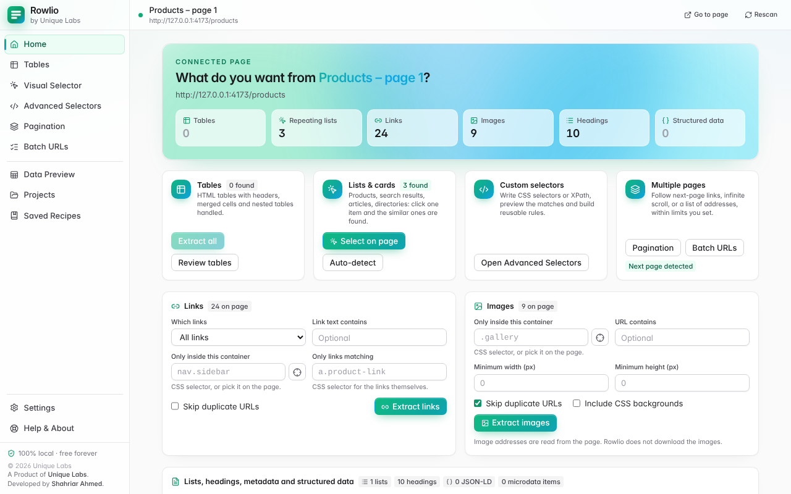
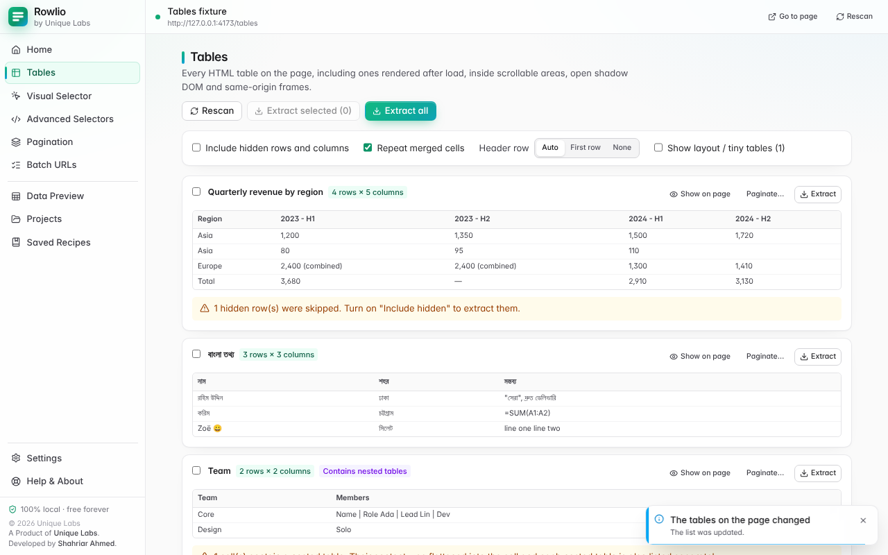
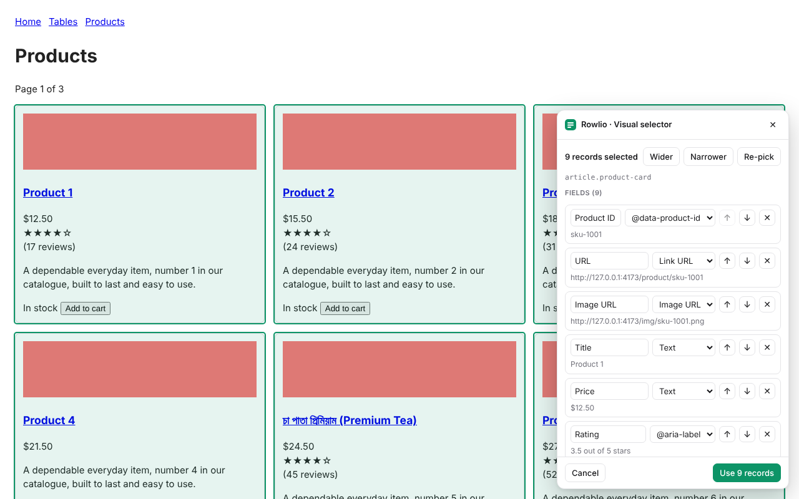
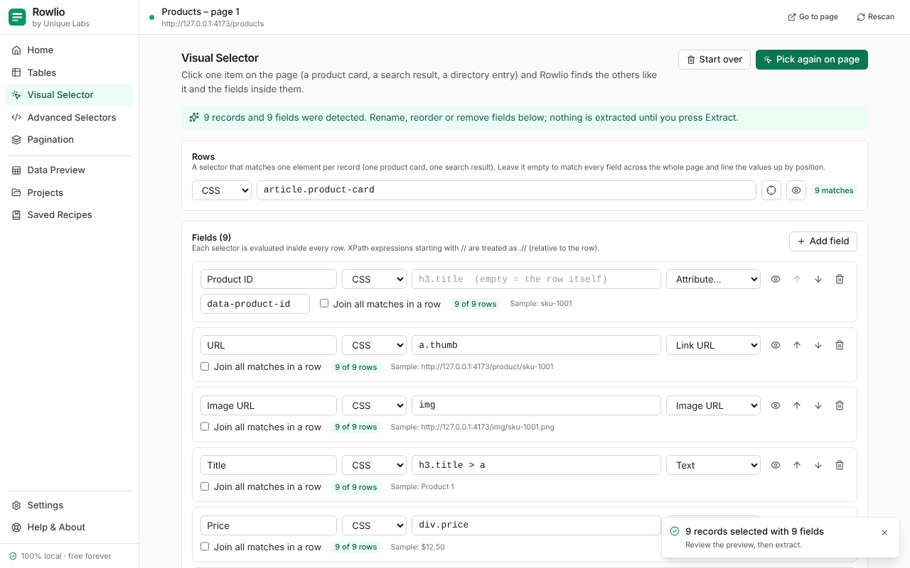
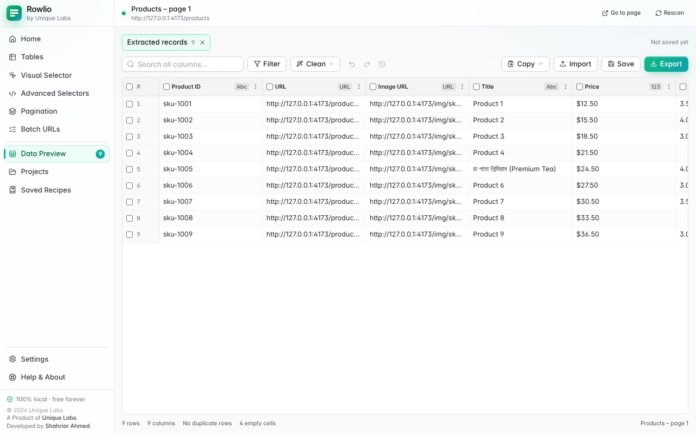
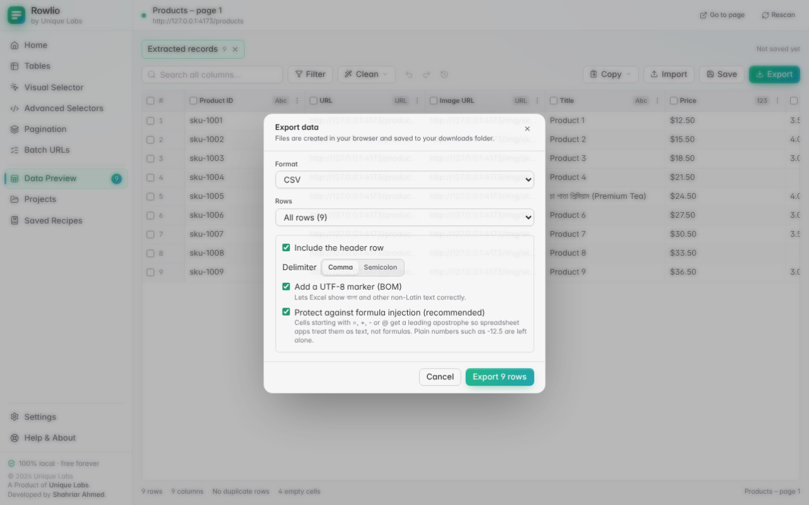
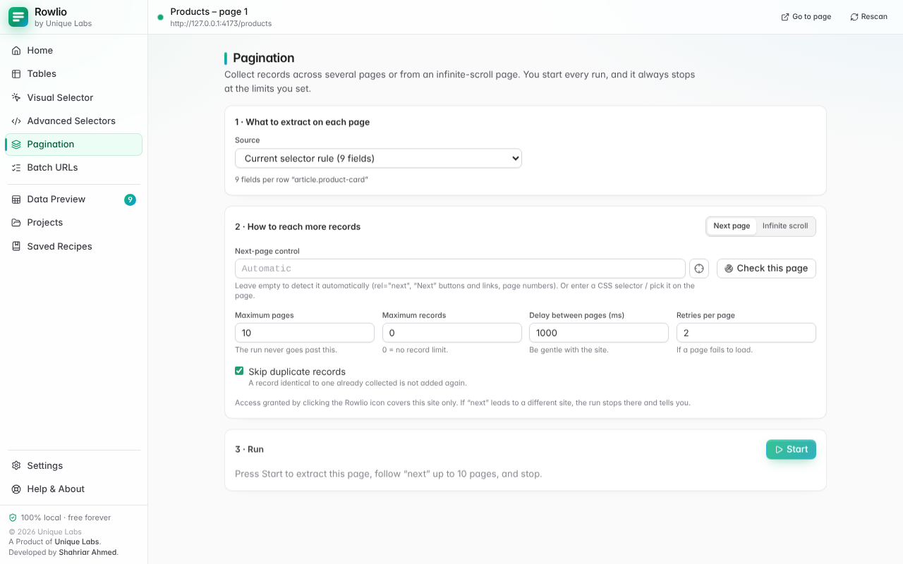
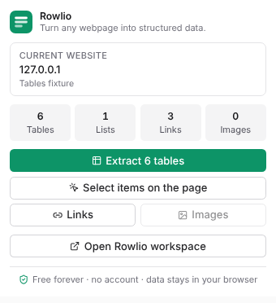

<div align="center">


<picture>
  <source media="(prefers-color-scheme: dark)" srcset="https://readme-typing-svg.demolab.com?font=Fira+Code&amp;weight=600&amp;size=22&amp;duration=3600&amp;pause=700&amp;color=FFB703&amp;center=true&amp;vCenter=true&amp;width=820&amp;height=48&amp;lines=Turn+any+webpage+into+structured+data;Tables%2C+lists%2C+links%2C+images+and+contacts;CSV%2C+Excel%2C+JSON%2C+Markdown+and+HTML;100%25+local+%C2%B7+no+account+%C2%B7+no+server;A+product+of+Unique+Labs" />
  <source media="(prefers-color-scheme: light)" srcset="https://readme-typing-svg.demolab.com?font=Fira+Code&amp;weight=600&amp;size=22&amp;duration=3600&amp;pause=700&amp;color=6C2BD9&amp;center=true&amp;vCenter=true&amp;width=820&amp;height=48&amp;lines=Turn+any+webpage+into+structured+data;Tables%2C+lists%2C+links%2C+images+and+contacts;CSV%2C+Excel%2C+JSON%2C+Markdown+and+HTML;100%25+local+%C2%B7+no+account+%C2%B7+no+server;A+product+of+Unique+Labs" />
  
</picture>

**Rowlio: Web Scraper & Data Extractor**

*A powerful, accessible, privacy-first web scraping and structured data extraction tool for everyone.*

<br/>


<br/>


<a href="https://www.uniquelabs.org"></a>
<a href="https://github.com/fr-ost"></a>

<br/>

A Product of [Unique Labs](https://www.uniquelabs.org). Developed by [Shahriar Ahmed](https://github.com/fr-ost).

</div>

## ✨ Overview

Rowlio turns tables, product listings, search results, links, images, contact details and page metadata into clean rows you can review, tidy up and export to **CSV, Excel, JSON, JSON Lines, TSV, Markdown or HTML**. Everything happens inside your browser: no account, no server, no usage limits, no premium tier.

Version **1.1.0** (see [CHANGELOG.md](CHANGELOG.md)) is not yet published to the Chrome Web Store. You install it from a local build, or from the archive the website build offers.

| | |
|---|---|
| **What it is** | A Manifest V3 Chrome extension |
| **Where it runs** | Entirely in your browser |
| **Account** | None |
| **Network calls of its own** | None. Extension pages cannot connect out (`connect-src 'self'`) |
| **Install-time permissions** | `activeTab` and `scripting` only |
| **Saved data** | Only when you save a project, only on your device (IndexedDB) |
| **Export** | CSV, XLSX, JSON, JSONL, TSV, Markdown, HTML, clipboard |

Free forever. Unlimited use. No subscription, no watermarks, and no data leaves your browser.

## 📸 Screenshots

<div align="center">



</div>

| | |
|---|---|
|  |  |
|  |  |
|  |  |

<div align="center">

*Screenshots are generated from the local test site with `npm run screenshots`.*



**The toolbar popup**

</div>

## ⚡ Key features

The complete list, including what is *not* supported, is in [docs/FEATURES.md](docs/FEATURES.md).

| | |
|---|---|
| **Tables** | Finds every HTML table (also ARIA grids, tables in open shadow DOM and same-origin frames, and tables rendered after load). Handles multi-row headers, `rowspan` / `colspan`, nested tables, hidden rows and columns, captions. |
| **Visual selector** | Click one item on the page; Rowlio finds the similar ones and the fields inside them (title, price, image, link, rating, reviews, date, availability, product id, tags …). Rename, reorder, remove or add fields by clicking. Falls back to "point at two examples" when no pattern is found. |
| **Advanced selectors** | CSS selectors and XPath with validation, match counts, sample previews and on-page highlighting. Extract text, HTML, attributes, link URLs, image sources. Multi-field rules with a row selector, or column mode. |
| **Page parts** | Links, images, lists, headings, breadcrumbs, metadata, JSON-LD, microdata. |
| **Contacts** | Email addresses, phone numbers and social profile links that the page shows or links to. |
| **Pagination and infinite scroll** | Next links / buttons, page numbers, or your own selector. Always user-started and bounded (pages, records, scrolls, time), with progress, retries, duplicate detection and a Stop button. |
| **Batch URLs** | Run one extraction over a list of pages you supply (pasted, or taken from a URL column of data you already extracted). Bounded, paced, stoppable; every row records the page it came from. |
| **Data preview** | Virtualised spreadsheet-style grid: edit cells, sort, search, filter, resize / reorder / rename columns, remove rows and columns, detect duplicates and empty values. Cleaning tools: trim, normalise whitespace, change case, extract numbers, parse dates, normalise URLs, find & replace, extract by pattern (regex), fill down, split and combine columns, add rows and columns, per-column summary. Full undo / redo and "restore original". |
| **Import** | Open a CSV, TSV, JSON or JSON Lines file from your computer and clean or convert it with the same tools. |
| **Export** | CSV, XLSX, JSON, JSONL, TSV, Markdown, HTML and clipboard, UTF-8 throughout, with formula-injection protection. |
| **Projects and recipes** | Save results locally (IndexedDB). Save extraction settings as reusable recipes that are offered again on matching pages. Project files use `.rowlio.json`; recipe files use `.rowlio-recipes.json`. |
| **Interface** | Animated, with a light, dark or system theme, and optional sound effects synthesised in the browser (no audio files, nothing downloaded). Sound and animation can each be switched off in Settings, and the system "reduce motion" preference is respected. |

## 🧰 Tech stack

<div align="center">


</div>

| Layer | What Rowlio actually uses |
|---|---|
| Extension | Manifest V3. Content script injected on demand. Minimum Chrome 120. |
| Workspace UI | React 19, TypeScript, Tailwind CSS 4, Zustand, Lucide icons, Inter (bundled) |
| Build | Vite, driven by `scripts/build.mjs` (pages, one classic content script, one service-worker module, generated manifest) |
| Extraction | DOM-only engine in the content script. No remote parser, no OCR, no AI service. |
| Large data | Web Worker for cleaning and export when the result is large |
| Storage | IndexedDB via `idb` — projects, recipes, settings |
| XLSX | `fflate` builds the ZIP container locally |
| Tests | Vitest (unit) and Playwright (end-to-end in Chromium) |
| Website | Hand-written HTML, CSS and JavaScript in `website/`. No analytics, no CDN, no web-font service. |

## 🚀 Getting started

**Requirements:** Node.js 20.19+ and Chrome 120+.

```bash
npm install
npm run build
```

Then in Chrome:

1. Open `chrome://extensions`.
2. Turn on **Developer mode**.
3. Click **Load unpacked** and choose the `dist` folder.
4. Pin Rowlio to the toolbar. Open any webpage and click the icon.

To produce the archive for the Chrome Web Store:

```bash
npm run package
```

This writes `release/rowlio-<version>.zip`. The packager refuses to package a test build (one that contains `host_permissions`).

The same archive is offered for download on the website (below), for people who want to install it without building. The file that ships with the site is `website/downloads/rowlio-<version>.zip`. Refresh it with `npm run package` followed by `npm run website`, and commit it after a release.

## ⚙️ Configuration

The extension reads **no API keys, tokens or `.env` file**. There is no account and no remote configuration.

Product name, store title, tagline, descriptions, colours, URLs, copyright line and credits live in one file, [`brand.config.json`](brand.config.json). The manifest, UI, website, filenames and icons are generated from it. Edit that file to change branding; do not hard-code those strings elsewhere.

Keyboard shortcuts (change them at `chrome://extensions/shortcuts`):

| Shortcut | Action |
|---|---|
| `Alt+Shift+R` | Open the popup |
| `Alt+Shift+W` | Open the workspace for the current tab |
| `Alt+Shift+S` | Start the visual selector |

### Environment variables

These names are read by local scripts and tests only. None of them hold secrets.

| Variable | What sets it | Default |
|---|---|---|
| `ROWLIO_SCREENSHOTS` | `npm run screenshots` sets it to `1` so the screenshot spec runs. Unset, the spec skips. | unset |
| `ROWLIO_E2E_PORT` | Port of the local fixture site used by Playwright | `4173` |
| `PORT` | Port for `npm run website:preview` | `4321` |

## 🧭 Using it

1. Open a webpage.
2. Click the Rowlio icon. The popup shows what the page contains.
3. Choose **Extract tables**, **Select items on the page**, **Links**, **Images**, or open the workspace for everything else.
4. Review and clean the data in the Data Preview.
5. Export, or save as a project. Save the extraction settings as a recipe to reuse them.

Rowlio does not bypass logins, paywalls, CAPTCHAs or anti-bot systems, and is not a crawler: runs are started by you and bounded by limits you set.

## 🌐 Website

`website/` holds a static, dependency-free marketing site: the home page, a blog (ten articles in `website/_posts/`), About, Contact, Support, FAQ and Privacy Policy pages, with structured data, `sitemap.xml`, `robots.txt` and an RSS feed generated by the build.

To add an article, add an `.html` file to `website/_posts/` that starts with a JSON header comment (`title`, `description`, `date`, `tag`); the file name becomes the address. The site loads nothing from other origins: no analytics, no CDN, no web-font service.

```bash
npm run website
```

builds it into `website-dist/`, filling in the product name, tagline, credits and version from `brand.config.json` and `package.json`, and adding the screenshots, icons and the packaged extension.

```bash
npm run website:preview
```

serves it on `http://127.0.0.1:4321` (or `PORT`).

<details>
<summary><b>Deploying to Vercel</b></summary>

<br/>

Import this repository and deploy the repository root. The committed [`vercel.json`](vercel.json) tells Vercel to skip dependency installation, run `node scripts/website.mjs` and serve `website-dist/`; no settings need to be changed in the dashboard. If the Vercel project's Root Directory is set to `website` instead, `website/vercel.json` does the same job from there (it needs Vercel's default "include files outside the root directory" setting left on).

The download on the site is `website/downloads/rowlio-<version>.zip`, which `npm run package` followed by `npm run website` refreshes. Commit it after a release. Because Vercel does not run `npm run package`, that archive is **committed**.

This deployment has not been run from here: the build was verified locally only.

</details>

## 🧪 Development

```bash
npm run dev
```

rebuilds `dist/` on every change. Reload the extension on `chrome://extensions` to pick it up. The content script also needs the page reloaded, or Rowlio re-invoked.

```bash
npm run typecheck   # tsc --noEmit, strict
npm test            # Vitest unit tests
npm run test:e2e    # production build + e2e build, then Playwright
npm run verify      # typecheck + unit + end-to-end
```

End-to-end tests need the Chromium that matches the pinned Playwright version:

```bash
npx playwright install chromium
```

`npm run build:e2e` writes a **test** variant to `dist-e2e/` (localhost host permissions so Playwright can drive the extension). Never ship it. `npm run package` refuses to zip a build that still has `host_permissions`.

| Script | What it does |
|---|---|
| `npm run dev` | Builds `dist/` and rebuilds on change |
| `npm run build` | Regenerates third-party notices, then builds the production extension into `dist/` |
| `npm run build:e2e` | Test variant into `dist-e2e/`. Never ship it |
| `npm run typecheck` | `tsc --noEmit` in strict mode |
| `npm test` / `npm run test:watch` | Unit tests |
| `npm run test:e2e` | Builds both variants and runs Playwright |
| `npm run verify` | Type check + unit tests + end-to-end tests. Run before every release |
| `npm run package` | Builds and writes `release/rowlio-<version>.zip`. Refuses a test build |
| `npm run icons` | Regenerates `public/icons/*.png` from the SVG (uses Playwright's Chromium) |
| `npm run licenses` | Regenerates `public/THIRD_PARTY_NOTICES.txt`; fails on a missing or non-permissive licence |
| `npm run screenshots` | Regenerates `docs/screenshots/*.png` (1280×800) from the fixture site |
| `npm run store-assets` | Regenerates the Chrome Web Store graphics in `store-assets/` |
| `npm run website` | Builds the marketing site into `website-dist/` (Node built-ins only) |
| `npm run website:preview` | Builds the site and serves it on `http://127.0.0.1:4321` |

Details: [docs/DEVELOPMENT.md](docs/DEVELOPMENT.md) and [docs/TESTING.md](docs/TESTING.md).

## 🏗️ Architecture

A Manifest V3 extension built with Vite, React, TypeScript and Tailwind CSS.

The **content script** is not registered in the manifest: it is injected on demand into the one tab you invoke Rowlio on, and contains the DOM-only **extraction engine** plus the in-page visual selector (vanilla DOM inside a closed shadow root). The **workspace** (a full extension page) orchestrates everything: it talks to the content script over a typed message protocol, streams large results in chunks, cleans data (in a Web Worker when large), stores projects in IndexedDB and builds export files locally. The **service worker** is deliberately tiny and stateless: it opens the workspace and handles keyboard shortcuts. There is no backend.

See [docs/ARCHITECTURE.md](docs/ARCHITECTURE.md).

<details>
<summary><b>Why plain Vite instead of WXT or CRXJS?</b></summary>

<br/>

The extension needs exactly three bundles (pages, one classic-script content file, one service-worker module) and a generated manifest. A build script of about 190 lines (`scripts/build.mjs`) does that with no framework runtime, no injected reload client and no extra abstraction to keep up to date, and it makes the production bundle easy to audit: what you read in `src/` is what ships.

</details>

## 🔒 Privacy

- Two install-time permissions: `activeTab` and `scripting`. No access to any site until you click the icon there.
- Optional host permission for a single origin is requested only when you ask to keep access to that site. Chrome shows its own prompt. A batch stays on the site you invoked Rowlio on; addresses on other sites are skipped unless you granted access to that site. Only `http` / `https` addresses are opened.
- No network requests of its own. The extension pages' Content Security Policy forbids them (`connect-src 'self'`). The only links that lead outside are the two credit links (Unique Labs and the developer), which open in a new tab when you click them.
- No analytics, telemetry, ads, accounts, remote code or external AI services.
- Data is stored only when you save a project, only on your device, and you can delete it.
- The font is bundled. Sounds are generated locally. HTML export escapes cell text and uses the same formula-injection guard as CSV. The build fails if pages or stylesheets reference a remote resource.

Details: [docs/PRIVACY.md](docs/PRIVACY.md), [docs/PERMISSIONS.md](docs/PERMISSIONS.md), [docs/SECURITY.md](docs/SECURITY.md).

## ⚠️ Limitations

- Chrome blocks every extension on `chrome://` pages, the Chrome Web Store and a few other protected pages.
- Content in cross-origin iframes and closed shadow roots is unreachable.
- PDFs and text inside images are not parsed (no OCR).
- One-click access covers one site in one tab; if a tab (or pagination) moves to another site you click the icon again. For the same reason a batch of URLs stays on the site you invoked Rowlio on; addresses on other sites are skipped unless you granted access to that site.
- Importing reads CSV, TSV, JSON and JSON Lines; Excel (`.xlsx`) files cannot be imported.
- Sound effects need Chrome to allow audio for the page; the first sound plays after your first click.
- Image extraction lists image addresses; it does not download image files.
- Unsaved data lives in the workspace tab until you save or export it.
- Rowlio does not bypass logins, paywalls, CAPTCHAs or anti-bot systems, and is not a crawler: runs are started by you and bounded by limits you set.
- The interface is English only for now (the code is prepared for translation).
- Not yet tested against Microsoft Excel itself (XLSX output is verified with openpyxl, LibreOffice and read-excel-file).

## 🗂️ Project structure

```text
src/
  app/              workspace UI — pages, components, stores, services
  background/       stateless service worker
  content/          on-demand content script, picker, overlay
  extraction/       DOM extraction engine
  data-processing/  import, cleaning, column summary
  export/           CSV, XLSX, JSON, JSONL, TSV, Markdown, HTML
  pagination/       next-page, infinite scroll, batch runner
  storage/          IndexedDB projects, recipes, settings
  messaging/        typed messages between workspace and content script
  popup/            toolbar popup
  workers/          data Web Worker
  styles/           tokens, motion, theme
  config/           brand constants read by the UI
  i18n/             English strings, ready for catalogs
docs/               features, architecture, privacy, permissions, security, testing
website/            static marketing site and blog
scripts/            build, package, website, icons, licences, store assets
tests/              Vitest unit tests and Playwright end-to-end tests
public/             icons and THIRD_PARTY_NOTICES.txt
store-assets/       Chrome Web Store graphics
```

`manifest.json` is generated into `dist/` by the build. It is not committed.

## 📚 Documentation

| Document | Contents |
|---|---|
| [docs/FEATURES.md](docs/FEATURES.md) | Every feature, and what is not implemented |
| [docs/ARCHITECTURE.md](docs/ARCHITECTURE.md) | Modules, data flow, decisions, extension points |
| [docs/PRIVACY.md](docs/PRIVACY.md) | What is and is not collected or stored |
| [docs/PERMISSIONS.md](docs/PERMISSIONS.md) | Each permission and why it is needed |
| [docs/SECURITY.md](docs/SECURITY.md) | Threat model and mitigations |
| [docs/TESTING.md](docs/TESTING.md) | Test strategy, how to run, current results |
| [docs/DEVELOPMENT.md](docs/DEVELOPMENT.md) | Setup, scripts, conventions, release steps |
| [docs/CHROME_WEB_STORE_LISTING.md](docs/CHROME_WEB_STORE_LISTING.md) | Store listing draft and publishing checklist |
| [`website/`](website/) · [`vercel.json`](vercel.json) | Marketing website and its Vercel configuration |
| [CHANGELOG.md](CHANGELOG.md) | Release notes |

## 🎨 Brand

> [!IMPORTANT]
> "Rowlio" is the selected working brand. **Its availability has not been verified.** Before public release, independently check domain availability, the Chrome Web Store name, and trademark registers in the markets you plan to serve.

## 📜 Licence

> [!WARNING]
> **No licence has been chosen for Rowlio's own source code**, and this repository contains no `LICENSE` file. Until Unique Labs selects one, the code is "all rights reserved" by default: publishing the repository does not by itself allow others to copy, modify or redistribute it. Choosing a licence (for example MIT or Apache-2.0 for open source, or a proprietary licence) is a business decision that should be made before the repository is made public.

The copyright notice states who owns the work; it is not a licence.

Third-party code that ships inside the extension, all under permissive licences:

| Package | Version | Licence | Used for |
|---|---|---|---|
| react, react-dom, scheduler | 19.3.1 / 19.3.1 / 0.28.0 | MIT | Workspace and popup UI |
| zustand | 5.1.0 | MIT | UI state stores |
| lucide-react | 1.71.0 | ISC | Icons |
| idb | 8.0.4 | ISC | IndexedDB wrapper |
| fflate | 0.8.3 | MIT | ZIP container for XLSX files |
| tailwindcss | 4.3.5 | MIT | Generated stylesheet |
| @fontsource-variable/inter | 5.3.0 | OFL-1.1 | Interface typeface (Inter), bundled as a local font file |

Their full licence texts are collected into `THIRD_PARTY_NOTICES.txt` on every build (`scripts/licenses.mjs`, which fails the build on a missing or non-permissive licence) and shipped inside the extension. The website carries its own copy of the Inter font with its licence (`website/assets/fonts/OFL.txt`).

Development-only tools (not shipped): Vite, @vitejs/plugin-react, @tailwindcss/vite, Vitest, jsdom, read-excel-file, @types/* (MIT); TypeScript, Playwright, fake-indexeddb (Apache-2.0).

## 💜 Credits

<div align="center">

**© 2026 Unique Labs.** A Product of [Unique Labs](https://www.uniquelabs.org).

Developed by [Shahriar Ahmed](https://github.com/fr-ost), Co-Founder & COO of Unique Labs.
[Telegram](https://t.me/igfrostt) · [Unique Labs](https://www.uniquelabs.org)

*Useful technology. Accessible to everyone.*


</div>
